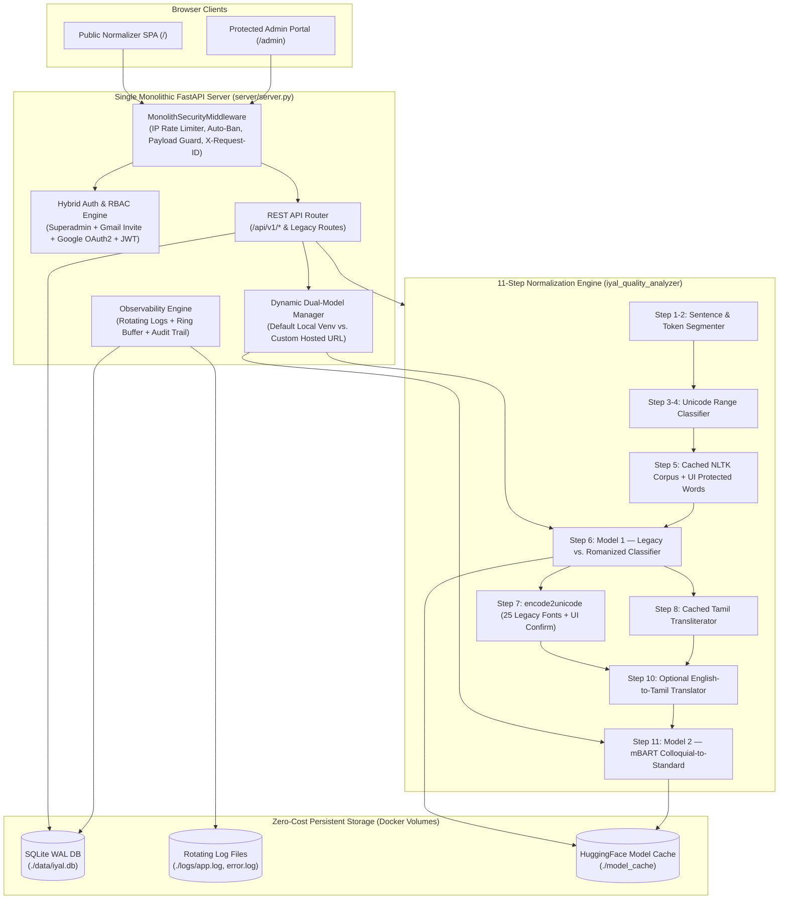
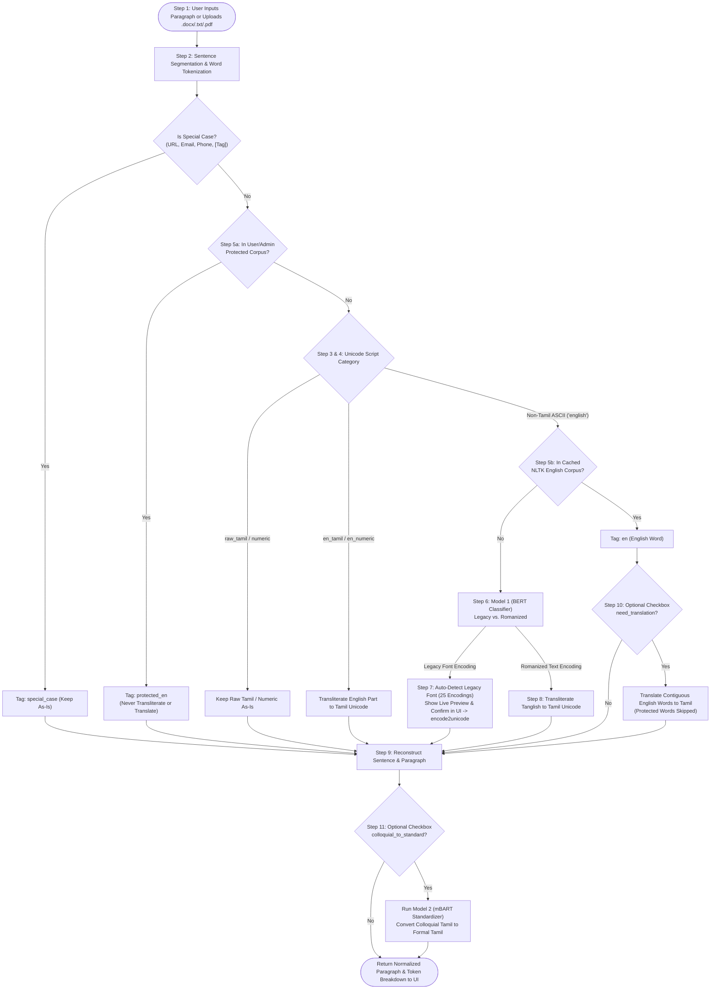
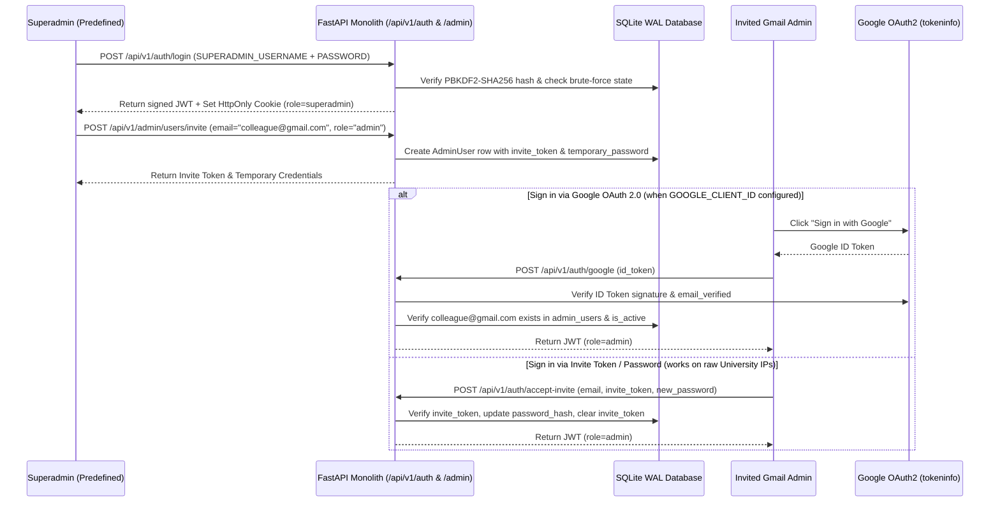

# Project IYAL v2.0 — Comprehensive Implementation & Architecture Report

## 1. Executive Summary
Project IYAL (**இயல்: Input Text Normalizer for Tamil Language**) has been completely re-engineered from a multi-container Streamlit + FastAPI + PostgreSQL prototype into a high-performance, zero-cost, security-hardened **Monolithic FastAPI Web Application & NLP Engine**.

Key achievements:
- **Repository Cleanup**: Removed all non-runtime research artifacts (`error_analyzis/`, `training/`, `imgs/`, `docs/build/`, legacy `feedback/`, and old `ui/`).
- **Monolithic Architecture**: Consolidated the Public UI (`/`), Admin Portal (`/admin`), REST APIs (`/api/v1/*` + legacy endpoints), DDoS/Brute-Force security middleware, and embedded SQLite WAL database into a single server.
- **1000x Pipeline Optimizations & Bug Fixes**: Fixed per-word NLTK corpus rebuilding, per-word legacy font set recomputation, `/get_encoding/` memory leaks, `googletrans`/`httpx==0.13.3` dependency conflicts, and Bamini pulli (`;`) stripping bugs.
- **Admin Portal (`/admin`) with Hybrid Gmail RBAC & Dual-Model Hot-Swap**: Predefined `superadmin` can invite `admin` users via Gmail, manage feedback, view live observability/security logs, and switch either ML model (`classifier` or `standardizer`) between `default` (local venv) and `custom` (hosted URL / HuggingFace repo).

---

## 2. System Architecture Diagram

---

## 3. The 11-Step Normalization Workflow Diagram

---

## 4. Admin Authentication, Gmail Invitation & RBAC Flow

---

## 5. Findings, Bugs Discovered & Recommendations During Testing

### Bugs Found in Original Codebase & Fixed in v2.0
1. **Severe Memory Leak & Latency in `/get_encoding/` (`server/server.py` line 174)**:
   - *Issue*: The original `/get_encoding/` endpoint instantiated a brand-new `Inference()` BERT model on **every HTTP request** (`inference_model = Inference()`), reloading ~438 MB of weights each time instead of reusing the startup singleton.
   - *Fix*: Reused the managed `model_manager.classifier` singleton across all requests.
2. **Per-Word NLTK Corpus Re-initialization (`english_word_check.py`)**:
   - *Issue*: `set(words.words())` (236,736 words) was reconstructed from disk on every single word token, and included single letters (`'f'`, `'m'`, `'c'`, `'v'`) and 2-letter strings (`'th'`, `'fh'`, `'gh'`) that collide with common Bamini Tamil syllables (`க`, `அ`, `உ`, `எ`, `வா`, `கா`, `பா`).
   - *Fix*: Cached `_ENGLISH_VOCAB` once in memory as a `frozenset`, removed Bamini syllable collisions, excluded tokens containing legacy punctuation markers (`;`), and added user-configurable Protected Corpus words.
3. **Bamini Pulli (`;`) Stripping Bug in `auto_detect_encoding` (`legacy_converter.py`)**:
   - *Issue*: `_get_unique_ch()` stripped `;` as a "special character" before matching unique encoding keys. In Bamini, `;` is the Tamil pulli (`்`). Stripping `;` turned `"cyfk;"` (`உலகம்`) into `"cyf"`, which falsely matched `"yf"` in `mylai2utf8` instead of `bamini2utf8`, and returned `None` when no match was found (breaking `ui/main.py`'s `if not auto_encoding == "legacy_font_not_found"` check).
   - *Fix*: Added Bamini `<consonant>;` pulli signature detection prior to stripping `;`, precomputed unique/common character sets at module import time (1000x speedup), and standardized `"legacy_font_not_found"` return values.
4. **Dependency Conflict in `requirements.txt` (`googletrans==3.1.0a0` & `httpx==0.13.3`)**:
   - *Issue*: `googletrans==3.1.0a0` pinned `httpx==0.13.3` and `httpcore==0.9.0`, conflicting with modern `fastapi`, `uvicorn`, and `huggingface-hub`.
   - *Fix*: Replaced with direct, connection-pooled, `@lru_cache`-backed `requests.Session()` calls to Google's Input Tools and `gtx` translation endpoints.
5. **HuggingFace Model Cache & `mBART` Loading (`inference.py` & `inference_coll_to_stand.py`)**:
   - *Finding*: On HuggingFace Hub, `sanujen/mBART_Tamil_Colloquial_to_Standard` has `optimizer.pt` (4.88 GB) committed in the repo alongside `model.safetensors` (2.44 GB), and its HF Hub `pipeline_tag` is `text-generation` rather than `text2text-generation`.
   - *Fix & Recommendation*: Switched `inference_coll_to_stand.py` to use `AutoTokenizer` + `AutoModelForSeq2SeqLM.from_pretrained` (which downloads only `model.safetensors` and ignores the 4.88 GB `optimizer.pt`) and checks the local HuggingFace cache (`local_files_only=True`) first before attempting network downloads. **Recommendation for repo owners**: Delete `optimizer.pt`, `scheduler.pt`, and `rng_state.pth` from the HuggingFace repo `sanujen/mBART_Tamil_Colloquial_to_Standard` to keep the HuggingFace repository clean.

